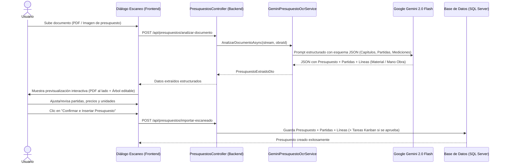

# Plan de Implementación: Escaneo e Importación Inteligente de Presupuestos con IA

## 1. Visión General del Flujo

Reutilizar y extender la arquitectura probada en el escaneo de facturas (`GeminiFacturaOcrService`) para incorporar la funcionalidad de **escaneo e inserción inteligente de presupuestos** (vía PDF o imagen con IA).

---

## 2. Fase 1: Backend - Servicio de Extracción OCR con Gemini

### 2.1 Estructura Real del Presupuesto (según documento aportado)
En presupuestos reales de subcontrata o cliente (como el ejemplo de *Alupadilla / Cortizo*):
* **Cabecera:** 
  * Número de presupuesto (ej. `2.026.000.102/1`)
  * Fecha de solicitud / emisión (ej. `22/09/2026`)
  * Obra / Proyecto asociado (ej. `SUSTITUCION MOTORES GRUPO ZETA`)
  * Cliente o Empresa (ej. `GINLONG S.L.`)
* **Posiciones / Partidas (Precio Unitario / Alzado):**
  * Cada partida viene como unidad completa (ej. `Pos. 1 - MOTORES FACHADA LAMAS`, Cantidad: 12, Precio unitario: 436,00 €, Total: 5.232,00 €) **sin desglose interno de qué parte es material y qué parte son horas**.
  * Texto descriptivo detallado del trabajo y especificación técnica.
* **Posiciones de Notas / Condiciones:**
  * Posiciones como `Pos. 2 - NOTAS...` contienen condiciones comerciales, plazos de validez (30 días), formas de pago (50% aceptación, 50% fin). La IA debe extraerlas como **Observaciones / Condiciones del Presupuesto**, no como partidas facturables con importe 0.

### 2.2 DTOs Adaptados del Presupuesto Extraído
Definir los contratos en `TareasObras.Application.Features.Presupuestos.DTOs`:

* **`PresupuestoExtraidoDto`**:
  * `Numero`: Referencia (ej. *2.026.000.102/1*).
  * `Fecha`: Fecha detectada (ej. *22/09/2026*).
  * `ObraSugeridaTexto`: Nombre de obra identificado en el documento (*SUSTITUCION MOTORES GRUPO ZETA*).
  * `ClienteNombre`: Nombre del cliente (*GINLONG S.L.*).
  * `Descripcion`: Concepto u observaciones/condiciones comerciales detectadas.
  * `BaseImponible`: 5.232,00 €.
  * `PorcentajeIva`: 21,00%.
  * `ImporteIva`: 1.098,72 €.
  * `ImporteTotal`: 6.330,72 €.
  * `DocumentoUrl`: Ruta temporal del archivo guardado.
  * `Partidas`: Lista de partidas extraídas.
* **`PartidaExtraidaDto`**:
  * `NumeroPosicion`: Posición original (ej. 1, 2...).
  * `Nombre`: Título de la partida (ej. *MOTORES FACHADA LAMAS*).
  * `Descripcion`: Detalle técnico completo de la posición.
  * `Unidad`: *ud*, *m2*, *pa*, etc. (o detectada en el texto / por defecto *ud*).
  * `Cantidad`: Cantidad (ej. 12,00).
  * `PrecioUnitario`: Precio unitario (ej. 436,00 €).
  * `Importe`: Importe total de la partida (ej. 5.232,00 €).
  * `TipoSugerido`: `Material` o `ManoObra` (o tipo predeterminado `Material` para cómputo económico, permitiendo al usuario cambiarlo o marcar si genera tarea en Kanban).
  * `GenerarTareaKanban`: Booleano (por defecto `true` para partidas de obra como montaje/sustitución).

### 2.3 `GeminiPresupuestoOcrService`
Implementar el extractor en `TareasObras.Infrastructure.Services`:
* Reutilizar `HttpClient` y la API Key de Gemini (`gemini-2.0-flash`).
* **Prompt especializado en documentos comerciales y de obra:**
  * Reconocimiento de tablas de posiciones (`Pos.`, `Nº`, `Importe (€)`, `Total (€)`).
  * Discriminación automática entre **Partidas de obra reales** y **Bloques de notas/condiciones** (para no meter las notas como partidas vacías).
  * Identificación de condiciones de pago y validez para guardarlas en la descripción del presupuesto.

---

## 3. Fase 2: Backend - Comandos y Controladores de Inserción Atómica

### 3.1 Comando `ImportarPresupuestoEscaneadoCommand`
Crear un comando en MediatR que permita la inserción transaccional completa:
1. Crea la entidad `Presupuesto` con el siguiente número de versión para la obra.
2. Vincula el archivo PDF original guardado en `FileStorageService` para poder consultarlo en el histórico.
3. Para cada partida escaneada, crea la `PartidaPresupuesto` y su `LineaPartida` representativa (con la descripción técnica, unidad, cantidad y precio unitario extraídos).
4. **Generación de Tareas Kanban:** Si el usuario aprueba el presupuesto (o si marca generar tareas), cada partida marcada como ejecutable genera automáticamente una tarea en el tablero **Kanban** vinculada a la obra (ej. *"MOTORES FACHADA LAMAS - Sustitución de motores de accionamiento..."*).

### 3.2 Endpoints en `PresupuestosController`
* `POST /api/presupuestos/analizar-documento`: Recibe `IFormFile` (PDF/imagen) y opcionalmente `obraId`. Retorna `PresupuestoExtraidoDto`.
* `POST /api/presupuestos/importar-escaneado`: Recibe los datos validados por el usuario y realiza la inserción en base de datos.

---

## 4. Fase 3: Frontend - Diálogo Interactivo de Revisión y Previsualización

Inspirado en el componente actual `app-factura-imputar-dialog`, pero enfocado en partidas de obra:

### 4.1 Componente `PresupuestoImportarDialogComponent`
Un diálogo modal con 3 pasos (Wizard):
1. **Paso 1: Subida del Documento:**
   * Zona Drag & Drop para arrastrar el PDF o imágenes del presupuesto (JPG/PNG).
   * Barra de progreso y estado *"Analizando presupuesto con IA..."*.
2. **Paso 2: Revisión en pantalla dividida (Split View):**
   * **Panel Izquierdo:** Visor interactivo del documento original (PDF embebido con `SafeResourceUrl` o visor de imagen con zoom).
   * **Panel Derecho:** Formulario de cabecera y tabla editable de partidas:
     * Cabecera: Nº Presupuesto, Fecha, Cliente, Obra sugerida, Notas comerciales / Condiciones.
     * Tabla de Partidas:
       * Columnas: Posición, Nombre / Título, Descripción técnica, Cantidad, Unidad, Precio Unitario, Total, Toggle *"Crear tarea en Kanban"*.
     * Resumen de totales: Base Imponible, IVA (21%), Total Presupuesto (comparados con los totales detectados en el PDF).
3. **Paso 3: Confirmación e Inserción:**
   * Selector de obra de destino (preseleccionada si se invoca desde la pestaña de una obra).
   * Checkbox: *"Aprobar presupuesto automáticamente al importar"*.
   * Checkbox: *"Generar tareas en Kanban para las partidas seleccionadas"*.
   * Botón *"Guardar e Importar Presupuesto"*.

---

## 5. Fase 4: Integración en la Interfaz de Usuario

1. **En la ficha de la Obra ([obra-tab-presupuestos.component.html](file:///d:/Programacion/GitHub/TareasObras_v2/TareasObras_v2_frontend/src/app/features/obras/components/tabs/obra-tab-presupuestos/obra-tab-presupuestos.component.html)):**
   * Añadir un botón destacado junto a "Nuevo presupuesto":
     `[Importar con IA / Escanear Presupuesto]` (icono `pi pi-sparkles`).
2. **Feedback y Notificaciones:**
   * Notificación *Toast* informando del número de partidas y líneas creadas, y si se han generado tareas en el Kanban.

---

## 6. Plan de Ejecución por Pasos

| Tarea | Archivos / Componentes a modificar o crear |
| :--- | :--- |
| **Paso 1: Backend DTOs & Contrato** | `IPresupuestoOcrService.cs`, `PresupuestoExtraidoDto.cs`. |
| **Paso 2: Backend Gemini OCR** | `GeminiPresupuestoOcrService.cs` (prompt de presupuestos y clasificación). |
| **Paso 3: Backend Commands & Controller** | `ImportarPresupuestoCommand.cs`, `PresupuestosController.cs`. |
| **Paso 4: Frontend Service** | Extender `PresupuestosService` con `analizarDocumento()` e `importarEscaneado()`. |
| **Paso 5: Frontend Componente UI** | Crear `presupuesto-importar-dialog.component` (TS + HTML + CSS). |
| **Paso 6: Enlace en Pestaña Presupuestos** | Integrar el diálogo y el botón en `obra-tab-presupuestos`. |
| **Paso 7: Pruebas y Validación** | Probar con un PDF de presupuesto real y verificar la creación de partidas y tareas Kanban. |
